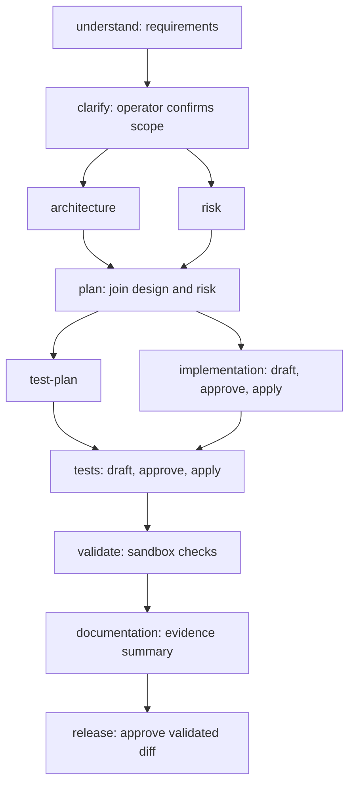

# Workflow orchestration: requirement-to-Java implementation guide

**This guide breaks the “Workflow Orchestration (Critical Differentiator)” requirement into 20 points and explains the code that implements each one.** The factory coordinates agents through a dependency graph, persistent state, deterministic policy checks and human decisions. Google ADK runs the agents; the Java control plane decides what may execute, change code, pass validation or receive approval.

Reviewed against the working-tree source on **15 October 2026**. Linked tests are existing verification coverage, not a claim that a fresh test run was performed for this document. Implementation limits are stated alongside the relevant requirement.

For dependencies and their purpose, application authentication and the wider architecture, see the [project presentation](../presentation/README.md). For operational commands, see the [operator guide](../03-operations/operator-guide.md).

## Where the Java files are

All orchestration production code is under [`factory/src/main/java/dev/softwarefactory/`](../../factory/src/main/java/dev/softwarefactory/). Corresponding tests are under [`factory/src/test/java/dev/softwarefactory/`](../../factory/src/test/java/dev/softwarefactory/).

| Package | What to look for |
| --- | --- |
| [`scenario`](../../factory/src/main/java/dev/softwarefactory/scenario/) | Task definitions, lifecycle stages, dependency graph, trusted feature workflow and invalidation rules. |
| [`run`](../../factory/src/main/java/dev/softwarefactory/run/) | Scheduler, persistent run state, task executors, approvals, retries, revision and recovery. Start with `RunEngine.java`. |
| [`generation`](../../factory/src/main/java/dev/softwarefactory/generation/) | ADK/Claude integration, role-specific prompts, upstream context and response recovery. |
| [`generation/tools`](../../factory/src/main/java/dev/softwarefactory/generation/tools/) | Repository/web tools, scoped draft tools, deadlines and tool-call limits. |
| [`governance`](../../factory/src/main/java/dev/softwarefactory/governance/) | Path restrictions, mandatory approval policy, patch checks and hashes. |
| [`candidate`](../../factory/src/main/java/dev/softwarefactory/candidate/) | Isolated Git worktrees, saved draft edits, diff generation and candidate reset. |
| [`validation`](../../factory/src/main/java/dev/softwarefactory/validation/) | Trusted Maven checks, Docker isolation, test-report inspection and generated-test policy. |
| [`audit`](../../factory/src/main/java/dev/softwarefactory/audit/) | PostgreSQL state/event journal, execution leases, evidence storage, HMAC audit chain and metrics. |
| [`operator`](../../factory/src/main/java/dev/softwarefactory/operator/) | HTTP, chat and CLI entry points, operator security and run inspection. |

The product being changed lives in [`shortener/src/main/java/`](../../shortener/src/main/java/). During a run, its proposed replacement lives in **`.runs/<run-id>/shortener/`**. A successful factory run does not automatically copy that code into the main `shortener/` directory.

## Requirement coverage at a glance

| Point extracted from the requirement | Implementation and scope |
| --- | --- |
| [1. Coordinate the full SDLC](#1-full-sdlc-coordination) | Requirements through release readiness are explicit tasks; release stops at an approved local candidate. |
| [2. Agentic orchestration beyond linear chaining](#2-agentic-orchestration-beyond-linear-chaining) | Role-based generation inside a governed scheduler with branches, pauses and re-execution. |
| [3. Stateful execution](#3-stateful-execution) | Durable PostgreSQL snapshots/events, evidence versions, leases and restart recovery. |
| [4. Explicit dependency graph](#4-explicit-dependency-graph) | Validated DAG with task IDs, dependencies, kinds, stages and write scopes. |
| [5. Entry and exit gates](#5-entry-and-exit-gates) | Dependency, integrity, scope, approval, validation and release checks. |
| [6. Sequential paths](#6-sequential-paths) | Tasks execute only after their prerequisites complete. Candidate mutations are serialized. |
| [7. Parallel paths and synchronization](#7-parallel-paths-and-synchronization) | Two eligible artifact branches can generate concurrently and join before downstream work. |
| [8. Cross-stage context](#8-cross-stage-context) | Requirement, direct dependency artifacts, source context, feedback and diagnostics enter prompts. |
| [9. Decision lineage](#9-decision-lineage) | Baseline/specification hashes, versioned evidence, operator decisions and approval hashes. |
| [10. Human approval checkpoints](#10-human-approval-checkpoints) | Feature scope confirmation, exact-hash patch approval and final release approval. |
| [11. Bounded retries](#11-bounded-retries) | Separate limits for generic task retries, draft repair, checks and response recovery. |
| [12. Fallback](#12-fallback) | Saved-file validation, smaller response recovery and diagnostic pauses; no automatic provider failover. |
| [13. Rollback](#13-rollback) | Reset/replay of local candidate changes; no production or database rollback. |
| [14. Safe-stop controls](#14-safe-stop-controls) | Policy/integrity failures stop the run; ordinary resume cannot bypass the stop. |
| [15. Security guardrails](#15-security-guardrails) | Restricted tools, scoped writes, isolated tests, local operator boundary and integrity checks. |
| [16. Compliance and change control](#16-compliance-and-change-control) | Enforced technical controls and recorded decisions; no regulatory certification or enterprise policy engine. |
| [17. Audit-grade observability and traceability](#17-audit-observability-and-traceability) | Tamper-evident event/state chain and evidence views, subject to local trust and retention limits. |
| [18. Reliability metrics](#18-reliability-metrics) | Completion, retries, rollback, task recovery and elapsed time; metric coverage has explicit gaps. |
| [19. Dynamic re-planning](#19-dynamic-re-planning) | Controlled dependency invalidation and re-execution; graph topology is trusted configuration. |
| [20. Controlled agent autonomy](#20-controlled-agent-autonomy) | Agents explore, draft and repair within capabilities; Java code and operators retain authority. |

## 1. Full SDLC coordination

**Requirement:** coordinate requirements, architecture/design, implementation, testing, documentation and release readiness.

[`FeatureScenario.create()`](../../factory/src/main/java/dev/softwarefactory/scenario/FeatureScenario.java) constructs the workflow used for a new feature request. [`Stage.java`](../../factory/src/main/java/dev/softwarefactory/scenario/Stage.java) names the lifecycle stages; [`TaskExecutors.java`](../../factory/src/main/java/dev/softwarefactory/run/TaskExecutors.java) dispatches each task kind to its implementation.

| Lifecycle responsibility | Feature task IDs | Actual action and Java executor |
| --- | --- | --- |
| Requirements | `understand`, `clarify` | Generate acceptance criteria, then require an operator answer/scope confirmation. [`ArtifactTask`](../../factory/src/main/java/dev/softwarefactory/run/ArtifactTask.java), [`ClarifyTask`](../../factory/src/main/java/dev/softwarefactory/run/ClarifyTask.java). |
| Architecture/design | `architecture`, `risk` | Produce design alternatives, affected contracts and risk analysis as separate artifacts. `ArtifactTask`. |
| Planning | `plan` | Combine design and risk into a concrete implementation/test plan. `ArtifactTask`. |
| Implementation | `implementation` | Draft production/API changes, check scope, obtain approval and apply to the candidate. [`PatchTask`](../../factory/src/main/java/dev/softwarefactory/run/PatchTask.java). |
| Testing | `test-plan`, `tests`, `validate` | Produce an independent test plan, draft a test patch for approval, then run trusted sandbox validation. `ArtifactTask`, `PatchTask`, [`ValidateTask`](../../factory/src/main/java/dev/softwarefactory/run/ValidateTask.java). |
| Documentation | `documentation` | Generate the engineering summary using upstream decisions and validation evidence. `ArtifactTask`. |
| Release readiness | `release` | Verify integrity and the validated candidate diff, then require final human approval. [`ReleaseTask`](../../factory/src/main/java/dev/softwarefactory/run/ReleaseTask.java). |

The diagram shows the main ordering. The scenario also supplies earlier requirements/design/risk/planning artifacts directly to documentation. Only the architecture/risk pair executes concurrently in this feature graph; the test-plan/implementation fork expresses dependencies but is not scheduled as a concurrent pair.

**Limits:** the documentation task writes an evidence artifact, not an automatic product README edit. Release approval marks readiness of the isolated candidate; it does not merge, push, publish or deploy it.

**Test coverage:** [`FeatureScenarioTest`](../../factory/src/test/java/dev/softwarefactory/scenario/FeatureScenarioTest.java), [`FeatureRequestGovernanceTest`](../../factory/src/test/java/dev/softwarefactory/run/FeatureRequestGovernanceTest.java).

## 2. Agentic orchestration beyond linear chaining

**Requirement:** implement an agentic orchestration layer with non-linear execution rather than a simple task chain.

[`RunEngine.java`](../../factory/src/main/java/dev/softwarefactory/run/RunEngine.java) exposes `start`, `advance`, `approve`, `clarify` and `revise`. [`AdvanceRun.advance()`](../../factory/src/main/java/dev/softwarefactory/run/AdvanceRun.java) repeatedly asks the graph which tasks are ready, executes eligible work, and stops at a decision or failure boundary. Revision can return an earlier task and its dependants to the queue without discarding unrelated results.

[`TaskGeneration.java`](../../factory/src/main/java/dev/softwarefactory/run/TaskGeneration.java) prepares work for the requested role. [`AdkClaudeRuntime.java`](../../factory/src/main/java/dev/softwarefactory/generation/AdkClaudeRuntime.java) builds an ADK `LlmAgent` and supplies a Claude model adapter plus permitted tools. Requirements, architecture, risk, implementation and testing roles have different task instructions, even when they use the same model.

The division of responsibility is deliberate: **ADK handles agent invocation; the custom Java engine owns lifecycle scheduling and governance.** A generated sentence saying “approved” or “completed” cannot set the run state.

**Test coverage:** [`RunEngineGenerationTest`](../../factory/src/test/java/dev/softwarefactory/run/RunEngineGenerationTest.java), especially `parallelBranchesJoinBeforeDownstreamWork`; [`RunEngineApprovalTest`](../../factory/src/test/java/dev/softwarefactory/run/RunEngineApprovalTest.java) covers revision and review transitions.

## 3. Stateful execution

**Requirement:** preserve execution state instead of restarting the workflow from memory each time.

[`RunState.java`](../../factory/src/main/java/dev/softwarefactory/run/RunState.java) stores task statuses, baseline/specification hashes, artifact versions/hashes, approvals, pending questions, retry counts, diagnostics, draft checkpoints and timestamps. [`DurableRunStore.record()`](../../factory/src/main/java/dev/softwarefactory/run/DurableRunStore.java) serializes that state. [`RunJournal.record()`](../../factory/src/main/java/dev/softwarefactory/audit/RunJournal.java) writes the event and updated snapshot together in a PostgreSQL transaction, rejecting a stale expected revision.

[`RunLeases.acquire()`](../../factory/src/main/java/dev/softwarefactory/audit/RunLeases.java) uses a PostgreSQL advisory lock so two processes cannot transition the same run simultaneously. [`RecoverInterruptedRun.recover()`](../../factory/src/main/java/dev/softwarefactory/run/RecoverInterruptedRun.java) inspects tasks left `RUNNING`: it can adopt a stored output, requeue unfinished work, or rebuild an interrupted patch candidate and invalidate downstream results.

The durable state lives outside the ADK in-memory session. Restarting the application can preserve workflow progress even though a new model invocation gets a newly assembled prompt.

**Test coverage:** [`DurableRunStoreTest`](../../factory/src/test/java/dev/softwarefactory/run/DurableRunStoreTest.java), [`ControlRecordIntegrationTest`](../../factory/src/test/java/dev/softwarefactory/audit/ControlRecordIntegrationTest.java), [`RunEngineResilienceTest`](../../factory/src/test/java/dev/softwarefactory/run/RunEngineResilienceTest.java).

## 4. Explicit dependency graph

**Requirement:** use an explicit dependency graph.

[`TaskSpec.java`](../../factory/src/main/java/dev/softwarefactory/scenario/TaskSpec.java) declares each node's `id`, `stage`, `dependsOn`, `kind`, `role`, prompt, acceptance criteria, `writeScope` and `requiresApproval`. [`ScenarioSpec.java`](../../factory/src/main/java/dev/softwarefactory/scenario/ScenarioSpec.java) collects the nodes. Fixed examples live in [`scenarios/`](../../scenarios/); feature requests use `FeatureScenario`.

[`TaskGraph.java`](../../factory/src/main/java/dev/softwarefactory/scenario/TaskGraph.java) rejects missing/duplicate identities, unknown dependencies, cycles, dependencies that reverse lifecycle stage order and patches without write scopes. For a release node, it requires approval, requires all other work to be upstream, and requires green validation downstream of every patch.

`TaskGraph.ready()` returns only pending nodes whose **every dependency is `DONE`**. The graph is acyclic; repeated work is expressed by changing task state through revision/recovery, not by adding a cycle to the graph.

**Test coverage:** [`TaskGraphTest`](../../factory/src/test/java/dev/softwarefactory/scenario/TaskGraphTest.java), including `rejectsCyclesAndUnknownDependencies` and `releaseCannotBypassValidationOrLeaveUnjoinedWork`.

## 5. Entry and exit gates

**Requirement:** enforce entry and exit gates.

Gates are implemented in Java task handlers and scheduler checks; there is no separate configurable gate-expression language.

| Boundary | Entry requirement | Exit requirement |
| --- | --- | --- |
| Advance a run | Nonterminal state, intact audited evidence, no pending operator decision, unchanged specification. | Record completion or a specific pause/failure state. |
| Execute a task | Pending status and all dependencies `DONE`. | Successful handler records output/state before downstream scheduling. |
| Apply a patch | Scope/test-policy/applicability checks pass; exact approval exists when required. | Apply to candidate, record patch evidence and clear the previous validation hash. |
| Complete clarification | Pending question and a nonblank operator answer. | Store the answer as evidence and mark the clarification done. |
| Pass validation | Required upstream patches complete. | Trusted checks pass; changed test classes must execute; pin the candidate diff hash. |
| Release | Joined upstream work, intact evidence and current diff matching the validated hash. | Human approves the exact release proposal; the release task becomes done. |

**Java:** [`AdvanceRun`](../../factory/src/main/java/dev/softwarefactory/run/AdvanceRun.java), [`PatchTask`](../../factory/src/main/java/dev/softwarefactory/run/PatchTask.java), [`AnswerClarification`](../../factory/src/main/java/dev/softwarefactory/run/AnswerClarification.java), [`ValidateTask`](../../factory/src/main/java/dev/softwarefactory/run/ValidateTask.java), [`ReleaseTask`](../../factory/src/main/java/dev/softwarefactory/run/ReleaseTask.java), [`SurefireReports`](../../factory/src/main/java/dev/softwarefactory/validation/SurefireReports.java).

**Limits:** `acceptanceCriteria` metadata does not automatically prove every business requirement. Generated documents require review. Also, [`ArtifactTask`](../../factory/src/main/java/dev/softwarefactory/run/ArtifactTask.java) does not implement an approval gate merely because `requiresApproval` is set; use the existing clarification/patch/release mechanisms rather than assuming that flag gates arbitrary document tasks.

**Test coverage:** [`RunEngineValidationTest`](../../factory/src/test/java/dev/softwarefactory/run/RunEngineValidationTest.java), [`RunEngineApprovalTest`](../../factory/src/test/java/dev/softwarefactory/run/RunEngineApprovalTest.java).

## 6. Sequential paths

**Requirement:** support sequential execution where order matters.

In the feature workflow, `tests` waits for both `implementation` and `test-plan`; `validate` waits for `tests`; release waits for documentation. `TaskGraph.ready()` enforces these dependencies. [`AdvanceRun.executeNext()`](../../factory/src/main/java/dev/softwarefactory/run/AdvanceRun.java) executes one ready task at a time unless it finds an eligible artifact pair.

Patch application and validation therefore do not race against another patch in the same run. The per-run lease also prevents a second UI/CLI/process action from advancing the candidate simultaneously.

**Test coverage:** [`TaskGraphTest.requiresJoinBeforeDownstreamTask`](../../factory/src/test/java/dev/softwarefactory/scenario/TaskGraphTest.java), [`RunEngineResilienceTest.concurrentAdvanceCannotAcquireTheSameRun`](../../factory/src/test/java/dev/softwarefactory/run/RunEngineResilienceTest.java).

## 7. Parallel paths and synchronization

**Requirement:** support parallel paths with synchronization.

[`AdvanceRun.executeNext()`](../../factory/src/main/java/dev/softwarefactory/run/AdvanceRun.java) selects at most **two ready `ARTIFACT` tasks without approval flags**. [`ParallelBranches.execute()`](../../factory/src/main/java/dev/softwarefactory/run/ParallelBranches.java) captures their inputs under the state lock, runs generation on Java virtual threads, collects results through an `ExecutorCompletionService`, then commits each outcome under the state lock.

`join()` waits for both branches within the configured generation deadline plus a one-minute join allowance. Policy failure cancels sibling work. The downstream `plan` task remains blocked until both architecture and risk are `DONE`.

**Limits:** this is bounded artifact concurrency, not arbitrary distributed DAG execution. Patches are not parallelized. A `PARALLEL_JOIN` event records that the join was handled; it can also follow a failed branch, so inspect task outcomes before calling the join successful.

**Test coverage:** [`RunEngineGenerationTest`](../../factory/src/test/java/dev/softwarefactory/run/RunEngineGenerationTest.java): `parallelBranchesJoinBeforeDownstreamWork`, `aPolicyStopOnOneBranchCancelsItsSibling`; [`RunEngineBehaviorTest`](../../factory/src/test/java/dev/softwarefactory/run/RunEngineBehaviorTest.java): `parallelPolicyFailureRemainsTerminalWhenAnotherBranchFails`.

## 8. Cross-stage context

**Requirement:** preserve context across stages.

[`TaskGeneration.prepare()`](../../factory/src/main/java/dev/softwarefactory/run/TaskGeneration.java) assembles the requirement, task instructions, operator review feedback, latest relevant failure diagnostic, direct dependency artifacts with their hashes, and current candidate source context. [`PromptBuilder.java`](../../factory/src/main/java/dev/softwarefactory/generation/PromptBuilder.java) formats these inputs; [`SourceContext.java`](../../factory/src/main/java/dev/softwarefactory/generation/SourceContext.java) supplies bounded source excerpts.

For example, `plan` receives architecture and risk outputs; documentation explicitly receives requirements, clarification, architecture, risk, plan, test plan and validation. The independent test-plan task runs before the implementation patch in this feature scenario.

**Limits:** only explicitly listed dependency artifacts are supplied directly; transitive information may arrive through an intermediate summary. Source context is bounded rather than a complete unlimited repository dump. Persistence does not guarantee that a model understands or follows every input.

**Test coverage:** [`PromptBuilderTest`](../../factory/src/test/java/dev/softwarefactory/generation/PromptBuilderTest.java), [`SourceContextTest`](../../factory/src/test/java/dev/softwarefactory/generation/SourceContextTest.java), [`RunEngineGenerationTest`](../../factory/src/test/java/dev/softwarefactory/run/RunEngineGenerationTest.java) for feedback and prior diagnostics on retry.

## 9. Decision lineage

**Requirement:** preserve where decisions and outputs came from.

[`StartRun.start()`](../../factory/src/main/java/dev/softwarefactory/run/StartRun.java) pins the baseline commit, requirement hash and exact scenario-file hash. [`RunEvidence.java`](../../factory/src/main/java/dev/softwarefactory/run/RunEvidence.java) writes versioned outputs, original proposals and diagnostics. [`EvidenceStore.write()`](../../factory/src/main/java/dev/softwarefactory/audit/EvidenceStore.java) refuses to replace an existing evidence name with different bytes.

[`ApprovalGate.patchHash()`](../../factory/src/main/java/dev/softwarefactory/run/ApprovalGate.java) binds patch bytes to the baseline, requirement, specification and current artifact-hash map. `releaseHash()` binds the complete candidate diff to current artifact hashes. Clarifications, feedback and approvals become recorded events with the configured operator label; old artifact versions remain after revision.

This lets a reviewer connect a proposed change to the inputs and decisions behind it. It does not provide independently authenticated human identity or a transcript of the model's private reasoning.

**Test coverage:** [`EvidenceStoreTest`](../../factory/src/test/java/dev/softwarefactory/audit/EvidenceStoreTest.java), [`RunStateTest.invalidationClearsEveryInputDerivedRecordButKeepsEvidenceVersions`](../../factory/src/test/java/dev/softwarefactory/run/RunStateTest.java), [`RunEngineApprovalTest`](../../factory/src/test/java/dev/softwarefactory/run/RunEngineApprovalTest.java).

## 10. Human approval checkpoints

**Requirement:** enforce human checkpoints for high-impact actions.

The feature workflow first uses [`ClarifyTask`](../../factory/src/main/java/dev/softwarefactory/run/ClarifyTask.java) and [`AnswerClarification`](../../factory/src/main/java/dev/softwarefactory/run/AnswerClarification.java) to confirm scope before design/code generation. Its implementation and test patches both require review. [`ApprovalGate.pause()`](../../factory/src/main/java/dev/softwarefactory/run/ApprovalGate.java) saves the exact proposal and pauses; [`ApproveStep.decide()`](../../factory/src/main/java/dev/softwarefactory/run/ApproveStep.java) rejects missing/stale review hashes and checks proposal integrity before recording approval. Rejection ends the run as `NOT_APPROVED`.

[`PatchPolicy.requiresApproval()`](../../factory/src/main/java/dev/softwarefactory/governance/PatchPolicy.java) also forces approval for sensitive paths such as dependency/build files, security/configuration code and schema migrations, even when a task flag would otherwise permit automatic application. Scope restrictions still apply: approval does not authorize an out-of-scope path. [`ReleaseTask`](../../factory/src/main/java/dev/softwarefactory/run/ReleaseTask.java) implements a separate final checkpoint.

**Timing matters:** patch approval happens after the draft is generated and before it is applied to the candidate. Scope confirmation is a separate earlier checkpoint. Other scenarios can have different gates; for example, the predefined greenfield scenario does not have the feature-request clarification step.

**Test coverage:** [`FeatureRequestGovernanceTest`](../../factory/src/test/java/dev/softwarefactory/run/FeatureRequestGovernanceTest.java), [`RunEngineApprovalTest`](../../factory/src/test/java/dev/softwarefactory/run/RunEngineApprovalTest.java), [`PatchPolicyTest`](../../factory/src/test/java/dev/softwarefactory/governance/PatchPolicyTest.java).

## 11. Bounded retries

**Requirement:** include bounded retries.

| Failure layer | Current behavior | Java implementation |
| --- | --- | --- |
| Generic task failure | First failure pauses with one retry available; second failure makes the run `FAILED`. The retry requires another advance. | [`FailureHandling`](../../factory/src/main/java/dev/softwarefactory/run/FailureHandling.java), `MAX_ATTEMPTS = 2`, `retryOrFail()`. |
| Draft repair | Up to three passes per `generate()` invocation; an unchanged repeatedly failing diff stops repair. | [`PatchDrafting`](../../factory/src/main/java/dev/softwarefactory/run/PatchDrafting.java), `MAX_PASSES = 3`. |
| Draft checks | At most three inspections of changed draft content per drafting invocation; identical content uses cached feedback. | [`DraftChecks`](../../factory/src/main/java/dev/softwarefactory/run/DraftChecks.java), `MAX_CHECKS = 3`. |
| Empty/truncated provider output | One response-recovery request for an unusable response; if recovery is still unusable, report generation unavailable. | [`ClaudeResponses.generate()`](../../factory/src/main/java/dev/softwarefactory/generation/ClaudeResponses.java). |
| Deterministic final validation failure | Pause with `REVISION_REQUIRED`; require upstream changes before continuing. | `FailureHandling.requireRevision()`. |
| Provider/platform unavailable | Pause while retaining work; do not consume the generic task retry allowance. | `FailureHandling.fail()`, `pauseForPlatform()`. |

There is **no model-call count budget**. [`TaskGeneration.reserveModelCall()`](../../factory/src/main/java/dev/softwarefactory/run/TaskGeneration.java) counts calls for observability. [`ToolSession`](../../factory/src/main/java/dev/softwarefactory/generation/tools/ToolSession.java) still enforces per-invocation tool limits and deadlines. Resume can start another bounded drafting invocation; these limits do not promise eventual success or impose a lifetime spending ceiling.

**Test coverage:** [`RunEngineBehaviorTest.retriesOnceThenStopsWithoutExecutingDownstreamWork`](../../factory/src/test/java/dev/softwarefactory/run/RunEngineBehaviorTest.java), [`PatchDraftingTest`](../../factory/src/test/java/dev/softwarefactory/run/PatchDraftingTest.java), [`TokenLimitRecoveryTest`](../../factory/src/test/java/dev/softwarefactory/generation/TokenLimitRecoveryTest.java), [`EmptyResponseRecoveryTest`](../../factory/src/test/java/dev/softwarefactory/generation/EmptyResponseRecoveryTest.java).

## 12. Fallback

**Requirement:** include fallback behavior when the normal path cannot complete.

[`ClaudeResponses.recover()`](../../factory/src/main/java/dev/softwarefactory/generation/ClaudeResponses.java) requests a smaller complete artifact or a small drafting-tool step after unusable output. In patch drafting, [`PatchDrafting.draftPass()`](../../factory/src/main/java/dev/softwarefactory/run/PatchDrafting.java) can catch generation unavailability and continue to trusted validation of already saved files when the task has a substantive downstream validator and a nonempty diff. Passing saved files can supply the Git-generated review diff even without a closing model message.

Otherwise, the run pauses with diagnostic evidence and preserves the draft. The operator can resume, revise with feedback or use an eligible recovery action. [`DraftWorkspace.java`](../../factory/src/main/java/dev/softwarefactory/candidate/DraftWorkspace.java) verifies saved work before reuse.

**Limits:** this is fallback to validated saved work or a controlled pause. There is no automatic switch to another model/provider, and a failed live run does not silently become a fixture run. Patches without substantive validation cannot use the missing-response shortcut to claim success.

**Test coverage:** [`PatchDraftingTest`](../../factory/src/test/java/dev/softwarefactory/run/PatchDraftingTest.java): `emptyFinalResponseStillValidatesSavedFilesAndRequiresApproval`, `providerPauseKeepsDraftAcrossNewEngineAndSuppliesDiagnosticOnResume`, `resumeChecksSavedDraftBeforeSpendingAnotherModelCall`.

## 13. Rollback

**Requirement:** include rollback controls.

[`CandidateRebuild.rebuild()`](../../factory/src/main/java/dev/softwarefactory/run/CandidateRebuild.java) resets the isolated candidate to its pinned baseline and reapplies completed patches that remain valid and are not excluded. [`GitWorkspace.reset()`](../../factory/src/main/java/dev/softwarefactory/candidate/GitWorkspace.java) performs the Git reset/clean inside that candidate. Revision uses this to remove stale effects; interrupted-patch recovery also resets/rebuilds the candidate and invalidates downstream validation.

The validation hash is cleared, so release requires validation of the resulting candidate. Historical evidence is retained even when its effects are removed from the worktree.

**Limits:** rollback covers the local candidate. It does not undo a production deployment, reverse a production database migration or create a compensating transaction in an external system.

**Test coverage:** [`RunEngineGenerationTest.anInterruptedPatchResetsTheCandidateAndRepeatsDownstreamValidation`](../../factory/src/test/java/dev/softwarefactory/run/RunEngineGenerationTest.java), [`RunEngineResilienceTest.recoveredPatchInvalidatesAndRerunsDownstreamValidation`](../../factory/src/test/java/dev/softwarefactory/run/RunEngineResilienceTest.java).

## 14. Safe-stop controls

**Requirement:** stop safely when continuing would violate policy or trust.

[`FailureHandling.safeStop()`](../../factory/src/main/java/dev/softwarefactory/run/FailureHandling.java) marks the offending task failed, sets `SAFE_STOPPED`, records a finish time and emits `POLICY_SAFE_STOP`. Security exceptions take this route. [`EvidenceIntegrity.verify()`](../../factory/src/main/java/dev/softwarefactory/run/EvidenceIntegrity.java) checks the audit chain and hashes of completed outputs before further work; altered evidence also stops execution.

[`RunStatus.isTerminal()`](../../factory/src/main/java/dev/softwarefactory/run/RunStatus.java) and `AdvanceRun.advance()` prevent ordinary resume from advancing a terminal run. A parallel policy violation cancels sibling work.

Unapproved draft test-content errors can be repair feedback rather than terminal violations, while scope/integrity violations still stop. [`DraftRecovery.java`](../../factory/src/main/java/dev/softwarefactory/run/DraftRecovery.java) contains a narrow checked recovery for a previously misclassified legacy test-tag stop; it is not a general override of security stops.

**Test coverage:** [`RunEngineBehaviorTest`](../../factory/src/test/java/dev/softwarefactory/run/RunEngineBehaviorTest.java), [`RunEngineResilienceTest`](../../factory/src/test/java/dev/softwarefactory/run/RunEngineResilienceTest.java), [`DraftRecoveryTest`](../../factory/src/test/java/dev/softwarefactory/run/DraftRecoveryTest.java).

## 15. Security guardrails

**Requirement:** embed security policy into execution.

| Threat/boundary | Enforced control and Java files |
| --- | --- |
| Agent edits outside its authority | [`PatchScope`](../../factory/src/main/java/dev/softwarefactory/governance/PatchScope.java), [`DraftFiles`](../../factory/src/main/java/dev/softwarefactory/candidate/DraftFiles.java) and [`GitWorkspace`](../../factory/src/main/java/dev/softwarefactory/candidate/GitWorkspace.java) restrict paths and check patch applicability. |
| Arbitrary shell/host access | [`EngineeringTools`](../../factory/src/main/java/dev/softwarefactory/generation/tools/EngineeringTools.java) exposes a fixed read/search/time catalog; [`DraftTools`](../../factory/src/main/java/dev/softwarefactory/generation/tools/DraftTools.java) adds scoped scratch edits and trusted checks, not a general shell. |
| Repository/web content injecting instructions | [`PromptBuilder`](../../factory/src/main/java/dev/softwarefactory/generation/PromptBuilder.java) and [`UntrustedText`](../../factory/src/main/java/dev/softwarefactory/generation/UntrustedText.java) delimit source/artifact text; deterministic policy remains outside model control. |
| Reading private/local network resources | [`RepositoryReader`](../../factory/src/main/java/dev/softwarefactory/generation/tools/RepositoryReader.java), [`WebAccessPolicy`](../../factory/src/main/java/dev/softwarefactory/generation/tools/WebAccessPolicy.java) and [`PublicWebReader`](../../factory/src/main/java/dev/softwarefactory/generation/tools/PublicWebReader.java) constrain file and web access. |
| Generated code executing on the host | [`DockerSandbox`](../../factory/src/main/java/dev/softwarefactory/validation/DockerSandbox.java) uses a trusted POM, offline Maven, read-only mounts/root, resource limits and dropped capabilities. Full-suite database checks use a disposable database's isolated network namespace. |
| Tests evading validation | [`GeneratedTestPolicy`](../../factory/src/main/java/dev/softwarefactory/validation/GeneratedTestPolicy.java) checks test modifications; [`SurefireReports`](../../factory/src/main/java/dev/softwarefactory/validation/SurefireReports.java) verifies actual execution/results. |
| Unauthorized browser mutations | [`LocalOperatorFilter`](../../factory/src/main/java/dev/softwarefactory/operator/security/LocalOperatorFilter.java) checks loopback host/origin and requires the page-issued token for protected mutations. |

**Limits:** this is a trusted local-operator model. The token is not enterprise authentication or RBAC; operator names are asserted labels. The host and Docker daemon remain trusted. Test-policy checks and prompt delimiters do not prove arbitrary generated code safe. The sandbox gets explicit disposable test settings/credentials, not host provider or control-database credentials. See the [security model](../04-quality/security.md) for the full boundary.

**Test coverage:** [`PatchScopeTest`](../../factory/src/test/java/dev/softwarefactory/governance/PatchScopeTest.java), [`EngineeringToolsTest`](../../factory/src/test/java/dev/softwarefactory/generation/tools/EngineeringToolsTest.java), [`WebAccessPolicyTest`](../../factory/src/test/java/dev/softwarefactory/generation/tools/WebAccessPolicyTest.java), [`SandboxValidatorTest`](../../factory/src/test/java/dev/softwarefactory/validation/SandboxValidatorTest.java), [`LocalOperatorFilterTest`](../../factory/src/test/java/dev/softwarefactory/operator/security/LocalOperatorFilterTest.java).

## 16. Compliance and change control

**Requirement:** enforce compliance and change-control guardrails.

The current implementation supports technical change control: trusted graph definitions, bounded write authority, mandatory sensitive-path review, recorded operator decisions, stale-approval rejection, validation evidence and an audited release gate. [`PatchPolicy.java`](../../factory/src/main/java/dev/softwarefactory/governance/PatchPolicy.java), [`ApproveStep.java`](../../factory/src/main/java/dev/softwarefactory/run/ApproveStep.java), [`ReviseRun.java`](../../factory/src/main/java/dev/softwarefactory/run/ReviseRun.java) and [`ReleaseTask.java`](../../factory/src/main/java/dev/softwarefactory/run/ReleaseTask.java) enforce these controls independently of model recommendations.

When inputs change, derived results and approvals become stale; they cannot simply retain their former authority. A request to weaken tests or bypass review remains subject to Java policy checks even if the agent agrees with it.

**Limits:** these controls support a review process; they are not proof of regulatory compliance. There is no regulation-specific rule library, organization-wide approval matrix, independently authenticated separation of duties, or certified retention system. “Compliance” should be presented as implemented technical guardrails with these limits.

**Test coverage:** [`PatchPolicyTest`](../../factory/src/test/java/dev/softwarefactory/governance/PatchPolicyTest.java), [`GeneratedTestPolicyTest`](../../factory/src/test/java/dev/softwarefactory/validation/GeneratedTestPolicyTest.java), [`RunEngineApprovalTest`](../../factory/src/test/java/dev/softwarefactory/run/RunEngineApprovalTest.java).

## 17. Audit observability and traceability

**Requirement:** provide audit-grade observability and traceability.

[`RunJournal.java`](../../factory/src/main/java/dev/softwarefactory/audit/RunJournal.java) atomically records events and state snapshots. [`AuditChain.java`](../../factory/src/main/java/dev/softwarefactory/audit/AuditChain.java) computes HMAC-SHA256 over the previous hash, sequence, time, event type/detail and state; [`AuditKey.java`](../../factory/src/main/java/dev/softwarefactory/audit/AuditKey.java) supplies a key stored outside the database. [`AuditTrail.verify()`](../../factory/src/main/java/dev/softwarefactory/audit/AuditTrail.java) checks sequence/hash continuity and that the last audited snapshot matches current state.

Artifacts and diagnostics are stored in `evidence/<run-id>/` as files such as `architecture-v1.txt`. [`RunViews.java`](../../factory/src/main/java/dev/softwarefactory/operator/api/RunViews.java) and [`FactoryController.java`](../../factory/src/main/java/dev/softwarefactory/operator/api/FactoryController.java) expose run details, proposals, diagnostics and timeline information. [`EventTypes.java`](../../factory/src/main/java/dev/softwarefactory/audit/EventTypes.java) names core lifecycle events. Model/tool calls also record metadata; [`ClaudeResponses.java`](../../factory/src/main/java/dev/softwarefactory/generation/ClaudeResponses.java) records response identifiers, stop reasons, block types and token usage without private thinking content.

**Limits on “audit-grade”:** this is locally tamper-evident storage, not externally anchored immutable retention. A database writer can truncate the newest events and restore an older matching snapshot without detection; possession of both key and database permits rewriting. Legacy keyless-only chains offer weaker protection. `EvidenceIntegrity` verifies current completed artifacts; it does not hash-verify every historical diagnostic/proposal on every advance. Operators need a separate retention/export design for stronger audit requirements.

**Test coverage:** [`AuditChainTest`](../../factory/src/test/java/dev/softwarefactory/audit/AuditChainTest.java), [`ControlRecordIntegrationTest`](../../factory/src/test/java/dev/softwarefactory/audit/ControlRecordIntegrationTest.java), [`EvidenceStoreTest`](../../factory/src/test/java/dev/softwarefactory/audit/EvidenceStoreTest.java), [`RunViewsTest`](../../factory/src/test/java/dev/softwarefactory/operator/api/RunViewsTest.java).

## 18. Reliability metrics

**Requirement:** track success rate, retry/rollback frequency, MTTR and end-to-end latency.

[`RunMetrics.from()`](../../factory/src/main/java/dev/softwarefactory/audit/RunMetrics.java) derives per-run measurements from recorded events and timestamps. [`MetricsSummary.java`](../../factory/src/main/java/dev/softwarefactory/operator/api/MetricsSummary.java) aggregates them for **`GET /factory/api/metrics`**. The aggregate sample is the latest **100 updated runs**, split into `fixture` and `live`; it is not a lifetime or fixed-time-window service SLO.

| Requested measure | Current field and calculation | Interpretation |
| --- | --- | --- |
| Success rate | `completionRate = completedRuns / terminalRuns`; `null` if none ended. | Workflow completion among finished runs. Paused/running runs are excluded from this denominator. It is not deployed-feature success. |
| Retry frequency | `retryOffers` counts `RETRY_AVAILABLE`; `retryExecutions` counts a task start while that task has a tracked unresolved failure. `retryRunRate` is the share of sampled runs with at least one such execution. | Counts recorded task retries, not every internal model response recovery or draft repair. |
| Rollback frequency | `rollbacks` increments for `PARTIAL_REPLAN` and for `RUN_RECOVERED` containing `candidateReset=true`. `rollbackRunRate` is the share of sampled runs with at least one rollback. | Candidate rebuild operations. A replan counts even when no production patch had yet been applied. |
| MTTR-like recovery time | `meanRecoveryMillis` averages the time from the first tracked failure for a task to its subsequent `TASK_DONE`. | Task recovery time including operator waits. No recovered sample produces `null`, not zero. This is narrower than service incident MTTR. |
| End-to-end latency | `elapsedMillis` runs from `startedAt` to `finishedAt`, or to now if unfinished; `meanTerminalLatencyMillis` averages finished runs. | Includes review pauses and repair time; it is not just model/CPU execution time. |
| Supporting measures | `recoveredTasks`, `unresolvedFailures`, `parallelJoins`, `replans`, `approvalRequests`, plus run outcome counts. | Explain activity behind an aggregate rate; joins and approval requests alone do not prove success. |

**Coverage gap:** the failure clock currently starts on `RETRY_AVAILABLE`, `TASK_FAILED`, `POLICY_SAFE_STOP` and `REVISION_REQUIRED`. It does not start on `DRAFT_CHECK_FAILED`, `MODEL_GENERATION_PAUSED` or `INFRASTRUCTURE_UNAVAILABLE`. Consequently, internal draft repairs and some outages are absent from retry/recovery figures. Unrecovered failures remain separate rather than becoming zero-duration recoveries. Present these measurements as their actual definitions, not comprehensive availability or universal self-healing metrics.

For example, a tracked task failure at 10:00 followed by `TASK_DONE` at 10:04 contributes four minutes to task recovery time. A pause that only emits `MODEL_GENERATION_PAUSED` does not currently contribute such a sample.

**Test coverage:** [`RunMetricsTest`](../../factory/src/test/java/dev/softwarefactory/audit/RunMetricsTest.java): `measuresRecoveredFailureAndKeepsUnresolvedFailuresVisible`, `noRecoverySampleIsNotReportedAsZeroMttr`; [`RunViewsTest.metricsSeparateFixtureAndLiveRunsAndReportNothingForEmptySamples`](../../factory/src/test/java/dev/softwarefactory/operator/api/RunViewsTest.java).

## 19. Dynamic re-planning

**Requirement:** re-plan when upstream outputs change while maintaining governance.

[`Invalidation.descendants()`](../../factory/src/main/java/dev/softwarefactory/scenario/Invalidation.java) finds the changed node and every downstream dependant. [`ReviseRun.revise()`](../../factory/src/main/java/dev/softwarefactory/run/ReviseRun.java) records review feedback, invalidates that set, removes derived approval/patch/draft records, rebuilds the candidate from unaffected work, and requeues the affected nodes. Artifact version history remains. The run pauses after revision until it is advanced again.

If the scenario or requirement text changes on disk, [`AdvanceRun.advance()`](../../factory/src/main/java/dev/softwarefactory/run/AdvanceRun.java) emits `REPLAN_REQUIRED` instead of using old outputs against the new specification. Explicit revision then invalidates all old/new scenario tasks when the specification hash differs. Altering a completed evidence file directly is an integrity violation, not a supported re-planning mechanism.

**Concrete feature example:** revising `architecture` invalidates `architecture`, `plan`, `test-plan`, `implementation`, `tests`, `validate`, `documentation` and `release`. `understand`, `clarify` and the independent `risk` branch remain. Any removed patch effects leave the candidate; the replacement code needs fresh review and validation.

**Limits:** the system recomputes what must run within trusted graph definitions. It does not let the model freely create/delete/reorder governance nodes. A final validation failure requests an upstream revision; it does not autonomously choose and approve a new graph. Re-planning is dependency-aware and stateful, with an explicit operator control path.

**Test coverage:** [`InvalidationTest.preservesUnrelatedBranch`](../../factory/src/test/java/dev/softwarefactory/scenario/InvalidationTest.java), [`RunEngineApprovalTest`](../../factory/src/test/java/dev/softwarefactory/run/RunEngineApprovalTest.java): `aChangedScenarioPausesUntilTheOperatorExplicitlyReplans`, `revisionPreservesUnaffectedWorkAndWithdrawsPendingReviews`; [`RunEngineValidationTest`](../../factory/src/test/java/dev/softwarefactory/run/RunEngineValidationTest.java) for upstream revision after validation failure.

## 20. Controlled agent autonomy

**Requirement:** maintain governance while allowing agents to act autonomously.

Agents may inspect allowed source, search permitted public information, propose designs, write scoped scratch files and repair check failures within their invocation limits. They cannot grant approval, expand their write scope, choose arbitrary shell commands, mark validation passed, change the trusted graph or deploy a candidate.

[`AdkClaudeRuntime`](../../factory/src/main/java/dev/softwarefactory/generation/AdkClaudeRuntime.java) assigns role instructions and tools. [`ToolSession`](../../factory/src/main/java/dev/softwarefactory/generation/tools/ToolSession.java) limits an ordinary invocation to 12 tool calls and a drafting pass to 64; deadlines and bounded result sizes remain. [`DraftTools`](../../factory/src/main/java/dev/softwarefactory/generation/tools/DraftTools.java) delegates edits/checks to trusted implementations. [`PatchTask`](../../factory/src/main/java/dev/softwarefactory/run/PatchTask.java), [`ApprovalGate`](../../factory/src/main/java/dev/softwarefactory/run/ApprovalGate.java) and [`ReleaseTask`](../../factory/src/main/java/dev/softwarefactory/run/ReleaseTask.java) retain control over candidate changes and final acceptance.

This allows useful automatic repair inside a bounded draft pass while preserving human control over accepted changes. It does not guarantee that every error fixes itself: exhausted repair, missing infrastructure, invalid evidence and decisions requiring new scope can still require operator action.

**Test coverage:** [`AgentToolLoopTest`](../../factory/src/test/java/dev/softwarefactory/generation/AgentToolLoopTest.java), [`ToolSessionTest`](../../factory/src/test/java/dev/softwarefactory/generation/tools/ToolSessionTest.java), [`PatchDraftingTest`](../../factory/src/test/java/dev/softwarefactory/run/PatchDraftingTest.java), [`FeatureScenarioTest.userRequirementCannotChangeWorkflowAuthority`](../../factory/src/test/java/dev/softwarefactory/scenario/FeatureScenarioTest.java).

## Suggested code-review walkthrough

1. Open [`FeatureScenario.java`](../../factory/src/main/java/dev/softwarefactory/scenario/FeatureScenario.java) to see the lifecycle and dependencies, then [`TaskGraph.java`](../../factory/src/main/java/dev/softwarefactory/scenario/TaskGraph.java) to see their validation.
2. Follow [`RunEngine.java`](../../factory/src/main/java/dev/softwarefactory/run/RunEngine.java) into [`AdvanceRun.java`](../../factory/src/main/java/dev/softwarefactory/run/AdvanceRun.java) and [`ParallelBranches.java`](../../factory/src/main/java/dev/softwarefactory/run/ParallelBranches.java) for dispatch and synchronization.
3. Follow [`TaskGeneration.java`](../../factory/src/main/java/dev/softwarefactory/run/TaskGeneration.java) into [`PatchDrafting.java`](../../factory/src/main/java/dev/softwarefactory/run/PatchDrafting.java) for context and bounded repair.
4. Inspect [`PatchTask.java`](../../factory/src/main/java/dev/softwarefactory/run/PatchTask.java), [`ApproveStep.java`](../../factory/src/main/java/dev/softwarefactory/run/ApproveStep.java), [`ValidateTask.java`](../../factory/src/main/java/dev/softwarefactory/run/ValidateTask.java) and [`ReleaseTask.java`](../../factory/src/main/java/dev/softwarefactory/run/ReleaseTask.java) for the acceptance gates.
5. Inspect [`FailureHandling.java`](../../factory/src/main/java/dev/softwarefactory/run/FailureHandling.java), [`ReviseRun.java`](../../factory/src/main/java/dev/softwarefactory/run/ReviseRun.java) and [`CandidateRebuild.java`](../../factory/src/main/java/dev/softwarefactory/run/CandidateRebuild.java) for failure classification, invalidation and rollback.
6. Finish with [`RunJournal.java`](../../factory/src/main/java/dev/softwarefactory/audit/RunJournal.java), [`AuditTrail.java`](../../factory/src/main/java/dev/softwarefactory/audit/AuditTrail.java) and [`RunMetrics.java`](../../factory/src/main/java/dev/softwarefactory/audit/RunMetrics.java) to trace what is persisted, verified and measured.

For a reviewer demonstration using fixture/live modes, see [assignment readiness](../04-quality/assignment-readiness.md). Fixture success demonstrates the control flow with recorded outputs; fresh live evidence is needed to demonstrate model delivery quality.
