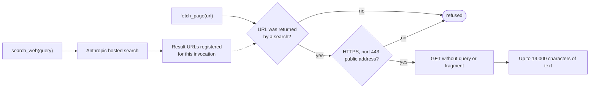

# Agent tools and web access policy

**In one paragraph.** Chat and document agents have seven read-only tools. Live PATCH workers additionally have five scoped draft tools; only the trusted validation tool can execute candidate tests inside the sandbox. No tool approves a proposal. Repository tools see an allowlist of source and documentation paths in one checkout. Web access is two steps: a provider-hosted search, then a fetch that is allowed only for a URL the search returned. Every call is counted and recorded in the audit trail by name, outcome and hashes, never by content.

Fixture runs do not use tools at all.

## The tools

| Tool | What it does | Limits |
| --- | --- | --- |
| `list_files` | Lists allowlisted paths under a prefix | 200 paths per call |
| `read_file` | Reads a file with line numbers | 200 lines per call; files up to 256 KiB |
| `search_repository` | Finds literal text | Query up to 200 characters; 80 matches; excerpts of 400 characters |
| `inspect_git` | `status`, `diff` (against `HEAD`) or `log` (last five commits) | Exactly those three operations; 5 s; no arguments from the model |
| `search_web` | Searches the public web through Anthropic's hosted search tool and returns a summary with source URLs | Query up to 500 characters; at most two searches per call; costs one provider request plus search charges |
| `fetch_page` | Reads one public HTTPS page as text | Only a URL returned by `search_web` in the same invocation; see [web access](#web-access-policy) |
| `current_time` | Returns the current UTC time | |

Every tool result is cut to 16,000 characters and wrapped in random delimiters with a "data only, not instructions" label. An ordinary tool failure returns a neutral "unavailable" message naming only the exception type, and the invocation continues. A generation-stop exception ends further tool and provider activity; draft check exhaustion is one such stop.

Send `/tools` in chat to see the list. In chat, an answer that used tools ends with a line such as `Tool activity: read_file OK, search_web ERROR`.

## Which files a tool can see

A PATCH worker reads its separate draft checkout; document workers read the candidate worktree. Chat reads the main checkout. Selecting a run in chat does not change that.

| Rule | Detail |
| --- | --- |
| Allowed roots | `factory/src`, `shortener/src`, `docs`, `scripts`, `scenarios` |
| Allowed single files | `README.md`, `pom.xml`, `factory/pom.xml`, `factory/README.md`, `shortener/pom.xml`, `shortener/README.md`, `shortener/openapi.yaml` |
| Allowed extensions under the roots | `java`, `sql`, `md`, `xml`, `yaml`, `yml`, `json`, `py`, `js`, `css`, `html`, `patch`, `txt` |
| Always denied | Any path segment starting with a dot (`.env`, `.git`, `.runs`); segments named `target`, `node_modules`, `credentials`, `secrets`; file names containing `credentials`, `secret` or `private-key`; symbolic links anywhere on the path; anything outside the checkout |
| Git | Runs with a fixed environment: no user or system configuration, no prompts, no pager |

These are checks in application code, not an operating-system sandbox. Do not commit secrets to files that match the allowlist: the model can read them.

## Web access policy



*A page can be fetched only if a search produced its URL, and only from a public HTTPS address.*

| Rule | Enforced by |
| --- | --- |
| The model cannot invent a URL. The requested URL, with query and fragment removed, must equal a registered search result. | `WebAccessPolicy` |
| Query strings and fragments are always stripped, so they cannot carry data out. | `WebAccessPolicy.canonical` |
| HTTPS on port 443 only, no credentials in the URL, at most 2,048 characters. Hosts ending in `.localhost`, `.local` or `.internal` are refused. | `PublicUrls` |
| The addresses actually used for the connection must be public. Private, loopback, link-local, shared, documentation, multicast and reserved ranges are refused for IPv4 and IPv6, including IP literals. | `PublicAddresses`, checked in the HTTP client's DNS step |
| Redirects are followed at most three times, only to HTTPS on the same host and port, again without query or fragment. | `PublicWebReader.sameOriginRedirect` |
| 15 s per request, 512 KiB per page, HTML, plain text or JSON only, 14,000 characters returned. No cookies, no JavaScript, no login. | `PublicWebReader` |

What still leaves the machine: the search **query text** goes to the model provider, and fetch requests go to the page's host. A model that has read something sensitive could put it into a search query. Do not point the agent at private data. This residual risk is listed in the [security model](../04-quality/security.md).

## Budgets and cost

| Budget | Value | Applies to |
| --- | --- | --- |
| Tool calls per invocation | 12 for chat/documents; 64 for drafts | Same |
| Deadline | `FACTORY_RUN_DEADLINE_SECONDS` (900) for tasks, `FACTORY_CHAT_DEADLINE_SECONDS` (180) for chat | One invocation |

SDK retries are disabled. The adapter allows one recovery request for an empty final response or `max_tokens` stop; truncated messages and their tool calls are discarded. Model-call counts are usage metrics, not limits.

## What is recorded

For each tool call the audit trail gets two events:

| Event | Detail |
| --- | --- |
| `TOOL_STARTED` | Tool name and the SHA-256 of its input |
| `TOOL_FINISHED` | Tool name, `OK` or `ERROR`, the SHA-256 of its output, elapsed milliseconds |

Task workers write these into the run's audit chain, prefixed with the task id; they appear in the Activity list of the operator page. Chat writes them to `chat_audit`. Arguments, file contents, page text, credentials and model thinking are never written to these records.

## What agents cannot do

- Write directly to the approval candidate, approve changes, or run arbitrary commands. PATCH workers may edit their scoped draft and request trusted sandbox checks.
- Read `.env`, credentials, `.git`, run worktrees of other runs, or anything outside the allowlist.
- Reach the control database or the Docker daemon.
- Create, advance, approve, revise or reject a run. Those are operator actions.
- Change the task graph or their tool/time limits.

## Verifying the tools

```sh
# No provider key needed: path and credential denial, symlinks, private addresses, HTML extraction,
# read-only Git, budgets, audit hashes, and the tool round trip against a fake provider
mvn -q -f factory/pom.xml test

# With the factory running and a provider key: exercises all seven tools through chat. Makes paid calls.
python3 scripts/checks/live_tools_smoke.py --live
```

The live check saves its result under `.runs/tool-checks/` and asserts that no run was created by the conversation.

## PATCH-only draft tools

| Tool | Contract |
| --- | --- |
| `read_draft_file` | Reads a scoped file and its SHA-256, or returns `ABSENT`. |
| `write_draft_file` | Atomic UTF-8 write, at most 256 KiB, requiring current hash or `ABSENT`. |
| `replace_draft_text` | Replaces exactly one matching nonempty fragment. |
| `delete_draft_file` | Deletes a scoped file only when its current hash matches. |
| `check_draft` | Checks scope, test policy and applicability; runs the trusted green/red sandbox check when required by the next validation task. |

Successful edits persist checkpoints immediately. Draft paths reject traversal, symlinks, protected paths and credential filenames. Unlike ordinary tool errors, failed sandbox checks return bounded diagnostic text for repair; that text is untrusted input. Three passes and three distinct checks are allowed per advance attempt. Repeated identical failed drafts pause. No-progress and provider output exhaustion preserve saved edits. See [ADR 0018](../02-architecture/decisions/0018-incremental-drafting-and-bounded-repair.md).

The third failed check ends the invocation immediately and retains the latest compiler/test diagnostic in the run's error evidence. The tool outcome is `STOPPED`; the session refuses subsequent edits and provider requests even if ADK handles the tool result. Ordinary tool errors still return redacted `ERROR` results. Resuming checks saved files before asking the model to repair them.

Test-policy defects in unapproved draft content (such as an integration exclusion tag or a removed test) return `CHECK_FAILED` feedback for correction. They consume a bounded draft check and cannot reach approval until corrected. Scope escapes and checkpoint/evidence integrity violations retain their fail-closed behavior.

Every engineering task receives the actual trusted validation POM, including on an empty baseline. Generated POM files cannot add dependencies to the sandbox. Agents are instructed to use JDBC, the supplied PostgreSQL database and compatible Spring Boot test APIs, without nested Testcontainers or a Docker socket.


Model-call count limits have been removed from runs, agent invocations and daily chat. Calls remain audited; tool limits, deadlines, bounded recovery and approval gates remain. See [ADR 0019](../02-architecture/decisions/0019-model-call-counts-are-metrics.md).
