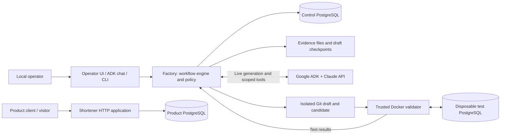
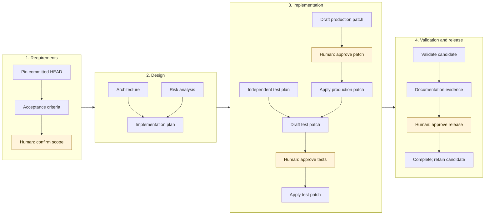
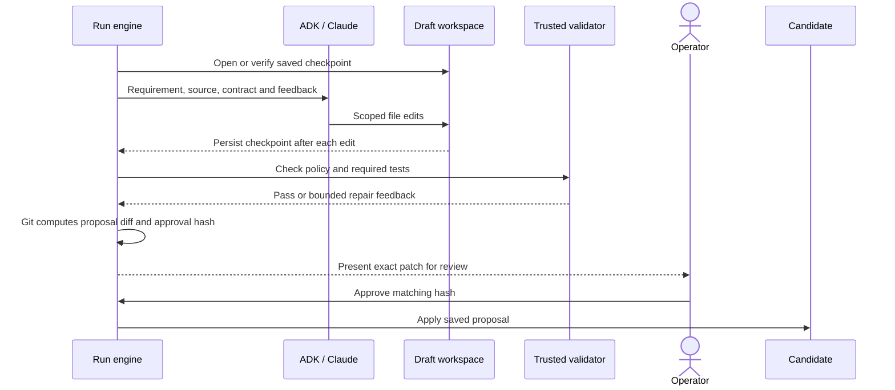
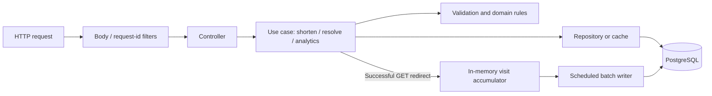

# Software Factory and URL Shortener — Project Presentation

**A guided walkthrough of the system, its dependencies, execution flow, approvals and security.**

Audience: project reviewers, developers and operators. Suggested presentation time: 25–35 minutes. Each numbered section can be presented as one slide or discussion topic.

Prepared on **15 October 2026**, against the current working-tree source. This document describes the repository's `factory/` and `shortener/` applications. Generated candidates under `.runs/` can have different APIs and designs until reviewed changes are integrated into the main project. Version numbers below are the versions declared in this repository, not claims about the latest available releases.

**Route:** purpose → architecture → dependencies → program flow → authentication and security → reliability → testing → release and operations.

Open this README on GitHub or in a Mermaid-enabled Markdown preview to display the diagrams.

For the detailed Java implementation behind each workflow requirement, read the [workflow orchestration requirement map](../02-architecture/workflow-orchestration-requirement-map.md).

---

## 1. What the project does

The repository contains two independently runnable Java applications:

| Application | Responsibility | Main users |
| --- | --- | --- |
| **URL shortener** (`shortener/`) | Create short links, redirect visitors and report aggregate visit counts | API clients and link visitors |
| **Software factory** (`factory/`) | Turn a requirement into proposed code, validate it and collect human approval with an audit record | A local operator and project reviewers |

The factory works on isolated copies of source code. Starting a run does not update the running shortener or its product database.

The main engineering idea is to make generated work inspectable: preserve its inputs, edits, test evidence and approval decisions rather than treating a model's “done” message as proof of delivery.

Sources: [root quickstart](../../README.md), [factory package guide](../../factory/README.md), [shortener package guide](../../shortener/README.md).

---

## 2. Architecture at a glance

**Read the diagram as two separate responsibilities:** the factory controls software changes; the shortener serves application traffic. The test database is disposable and separate from both persistent databases.

| Boundary | Why it exists |
| --- | --- |
| Factory versus product | Changes to generated code should not alter the factory's own authority or live product data |
| Draft versus candidate | Edits can be repaired before the exact proposal is approved and applied |
| Candidate versus sandbox | Generated code executes with restricted resources and access |
| Model versus workflow engine | The engine owns transitions, approvals and release decisions |

Sources: [factory architecture](../02-architecture/factory.md), [sandbox implementation](../../factory/src/main/java/dev/softwarefactory/validation/DockerSandbox.java).

---

## 3. Platform and runtime dependencies

| Dependency | Used for | Why this project uses it |
| --- | --- | --- |
| **Java 21** | Both applications; compiled with release 21 | One language for HTTP services, workflow logic, concurrency and tests; virtual threads are used for factory workers |
| **Maven 3.9+** | Multi-module build, dependency resolution and verification | Reproducible build commands shared by local development, CI and validation |
| **Spring Boot 4.1.1** | Parent of both application modules | Compatible dependency management, application lifecycle, configuration and embedded HTTP server |
| **PostgreSQL 16** | Product data and factory control data | Transactions, uniqueness constraints, durable state and advisory locks |
| **Git** | Baselines, isolated worktrees, diffs and patch application | Every proposal can be tied to a specific starting commit and reviewed as an exact change |
| **Docker / Compose** | Local databases and isolated validation | Repeatable development services and bounded execution of generated code |
| **Python 3** | Launchers, smoke checks and evaluation scripts | A small cross-platform orchestration layer around Java, Git and Docker |

The root POM is an **aggregator**, not the parent of the application modules. Each application inherits from Spring Boot and declares its own quality gate. Validator images are pinned by digest; the local Compose databases use the `postgres:16-alpine` tag.

Sources: [root POM](../../pom.xml), [factory POM](../../factory/pom.xml), [shortener POM](../../shortener/pom.xml), [Compose](../../compose.yaml).

---

## 4. Application libraries and why they are used

“Boot-managed” means the module's Spring Boot parent supplies the version.

| Library / starter | Module | Purpose and rationale |
| --- | --- | --- |
| `spring-boot-starter-webmvc` | Both | REST controllers, request mapping and an embedded servlet server; a conventional HTTP application model |
| `spring-boot-starter-security` | Both | Security filters and management endpoint rules; factory requests also pass through its custom local operator filter |
| `spring-boot-starter-jdbc` | Both | Explicit SQL and transactions without introducing an ORM; HikariCP provides connection pooling |
| `spring-boot-starter-validation` | Both | Validate request objects and configuration close to their boundaries |
| `spring-boot-starter-actuator` | Both | Health and readiness endpoints; Micrometer supports internal operational metrics |
| `spring-boot-starter-flyway`, `flyway-database-postgresql` | Both | Version and apply schema migrations, including PostgreSQL-specific support |
| PostgreSQL JDBC driver | Both | Connect Java's JDBC APIs to PostgreSQL; declared as a runtime dependency |
| Caffeine | Shortener | Bounded in-memory caches for links and known misses, reducing database work on redirects |
| Jackson `jackson-databind` and `jackson-datatype-jsr310` | Factory | Serialize run state, API data and Java time values through the factory's explicit JSON mapper |
| `spring-web`, `spring-webmvc`, `slf4j-api` | Factory, explicit declarations | Declare directly used HTTP and logging APIs instead of depending on accidental transitive availability |

All rows above are Boot-managed. HikariCP, Micrometer and the embedded server arrive through starters; they are not separately pinned direct dependencies here.

**Design choice:** the supported product stack is JDBC/PostgreSQL. JPA/Hibernate, H2, Redis and Testcontainers are not part of the trusted candidate validation contract. Adding a library to a generated POM does not make it available inside that validator.

Sources: [module POMs](../../factory/pom.xml), [product dependencies](../../shortener/pom.xml), [validation contract](../../factory/src/main/java/dev/softwarefactory/generation/ValidationContract.java).

---

## 5. AI, web tools and presentation assets

| Dependency | Declared version | Why it is present |
| --- | --- | --- |
| `google-adk` | 1.10.1 | Agent invocation, model/tool interaction and event handling |
| `google-adk-dev` | 1.10.1 | Bundled ADK development chat UI and its server integration |
| `anthropic-java-core`, `anthropic-java-client-okhttp` | 2.15.0 | Claude message types and provider access; pinned to the SDK version used by this ADK release |
| `okhttp-jvm` | 5.3.2 | HTTP connections for provider integration and controlled public-page fetching |
| RxJava 3 (`rxjava`) | Boot-managed | `Flowable` streams used by ADK, the Claude adapter and chat integration |
| jsoup | 1.23.2 | Extract bounded readable text from fetched HTML |
| Mermaid | 11.17.2 | Render diagrams in the custom chat assets |
| esbuild | 0.25.12 | Bundle those browser assets; a development dependency |

Google ADK supplies the agent runtime. Claude is the configured generation provider; using ADK does not imply that a Gemini model is required. The selected Claude model is configured through `CLAUDE_MODEL`.

The custom `ThinkingAwareClaude` adapter handles the response protocol and output recovery. Provider clients are shared and closed with the process. SDK retries are disabled so that requests go through the factory's explicit usage recording and retry handling.

The operator dashboard is static HTML/CSS/JavaScript backed by REST APIs. Node is used for asset builds and optional browser checks, not as the Java application's runtime server.

Sources: [factory POM](../../factory/pom.xml), [model clients](../../factory/src/main/java/dev/softwarefactory/generation/ModelClients.java), [chat asset package](../../scripts/chat-assets/package.json).

---

## 6. How the factory program starts and accepts work

1. `scripts/factory_web.py` loads accepted configuration, compiles the factory and starts `FactoryWebServer`.
2. Spring creates the database pool, runs Flyway migrations and wires the run store, audit trail, engine and model clients.
3. `/factory/` serves the operator dashboard; `/dev-ui/?app=software_factory` serves chat.
4. Operator requests pass through body limits and the local security boundary before reaching the API or command router.
5. `FactoryService` starts background work. `RunEngine` acquires the run lease and delegates to the workflow transitions.
6. `AdvanceRun` selects tasks whose dependencies are complete, runs them and stops at an operator decision, failure or completion.

The CLI calls the same engine without the browser. The engine is shared authority; the UI is a view and command surface.

| Package | Responsibility |
| --- | --- |
| `operator` | Dashboard API, chat commands, CLI and local request security |
| `scenario` | Trusted task graphs, dependencies and declared task scope |
| `run` | Scheduling, transitions, approvals, validation and recovery |
| `generation` | Prompts, ADK, Claude responses and scoped tools |
| `candidate` / `governance` | Git workspaces, edits, hashes and patch policy |
| `validation` / `audit` | Sandbox execution, test verdicts, persistent state and evidence |

Sources: [server composition](../../factory/src/main/java/dev/softwarefactory/operator/web/FactoryWebServer.java), [scheduler](../../factory/src/main/java/dev/softwarefactory/run/AdvanceRun.java).

---

## 7. Workflow and the meaning of approval

For a new `/feature` request, the workflow is:

Highlighted nodes require human input; architecture and risk form the parallel design branch. The plan is generated content within a fixed workflow. The model cannot change the scheduler's task graph or grant approval.

| Workflow | Starting point | Approval before implementation starts? | Later decisions |
| --- | --- | --- | --- |
| `/feature` | Committed `HEAD`, pinned to a SHA | Explicit requirements/scope confirmation; no separate design/plan approval checkpoint | Production patch, test patch and release |
| Built-in `greenfield` | `project-start` tag, pinned to a SHA | No; requirements, design, risk and plan run automatically | Combined `apply` patch and release |

**Approval of a patch happens after its draft exists.** It authorizes applying those exact bytes to the candidate. It does not authorize a future unknown patch. In greenfield, wording such as “approved design” in a prompt does not create a design approval checkpoint.

Sources: [feature workflow](../../factory/src/main/java/dev/softwarefactory/scenario/FeatureScenario.java), [greenfield workflow](../../scenarios/greenfield/scenario.json), [patch approval](../../factory/src/main/java/dev/softwarefactory/run/PatchTask.java).

---

## 8. Incremental implementation: from edits to a reviewed patch

For patches with a direct validation successor, draft checks run that validator before review. Intermediate patches can defer the full suite until their required downstream test patch exists. Candidate validation is still required before release.

- Writes are limited to the task's allowed paths in a separate draft repository.
- Each successful edit saves the draft location, base commit, input fingerprint and diff hash.
- Resume checks an eligible saved draft before another model call. A missing closing message can still lead to review when saved code passes substantive checks.
- Truncated provider responses are discarded; one bounded output-recovery attempt is allowed.
- A changed proposal or relevant input requires fresh approval. Approval never regenerates the reviewed patch.

Sources: [drafting](../../factory/src/main/java/dev/softwarefactory/run/PatchDrafting.java), [checks](../../factory/src/main/java/dev/softwarefactory/run/DraftChecks.java), [approval hashes](../../factory/src/main/java/dev/softwarefactory/run/ApprovalGate.java).

---

## 9. Persistence, concurrency and auditability

| Store | What it contains | Why it is separate |
| --- | --- | --- |
| Product PostgreSQL | `links` and `link_stats` | Application traffic and business data |
| Control PostgreSQL | `runs`, `audit_events`, `chat_budget`, `chat_audit` | Workflow authority, current state, history and usage accounting |
| `.runs/<run-id>/` | Isolated candidate worktree | Approved changes for one run |
| `.runs/drafts/` | Incremental, unapproved edits | Recovery without changing the candidate |
| `evidence/<run-id>/` | Task outputs, proposal snapshots and diagnostics | Human review and later inspection |

`chat_budget` is a historical table name: it now counts requests and does not enforce a model-call limit.

Each run transition uses a PostgreSQL advisory lease. A revision check rejects stale writers. State and the corresponding audit event are committed in one transaction.

Modern audit events form an **HMAC-SHA256 chain** covering the previous hash, event fields and state snapshot. The audit key is held outside the database. Completed evidence hashes and the audit chain are verified at workflow boundaries.

This detects many forms of tampering but is not an externally anchored ledger: deleting a suffix and restoring a matching earlier snapshot is a known limitation. Possession of both the key and database authority also defeats that protection.

Sources: [data model](../02-architecture/data-model.md), [run journal](../../factory/src/main/java/dev/softwarefactory/audit/RunJournal.java), [audit chain](../../factory/src/main/java/dev/softwarefactory/audit/AuditChain.java).

---

## 10. Authentication and authorization as implemented

There is **no application user-account, JWT, OAuth or role-based login system** in this prototype. The factory assumes one trusted local operator. The root shortener's public API is unauthenticated.

| Surface | Current control | What it establishes |
| --- | --- | --- |
| Factory web server | Binds to `127.0.0.1`; loopback host and same-origin checks | A local browser boundary |
| Factory API mutations | `X-Factory-Token`, issued by the local server | Possession of the current local capability token |
| Chat workflow commands / live sessions | Token checks at the request boundary; literal command routing | Permission to invoke local workflow operations |
| Ordinary chat | Local origin checks; provider key for model answers | Access to local conversational generation, not patch approval |
| Shortener API and redirects | Public; no login or HTTP Basic | Anonymous product access |
| Shortener management paths | Spring Security permits health/info and denies other management paths | Limited management exposure |
| Provider and databases | Server-side API key / separate database credentials | Service access, not operator identity |

The dashboard obtains the token from `/factory/api/config` and sends it with action requests. It is generated per server startup and compared in constant time. Any local process can obtain it. `FACTORY_OPERATOR` is an audit label, not a verified identity.

Spring's default CSRF mechanism is disabled in the factory's stateless security chain; the custom origin/token checks provide its local action boundary. Requests without an `Origin` header can pass the origin check. This design is unsuitable as remote-user authentication.

Sources: [local operator filter](../../factory/src/main/java/dev/softwarefactory/operator/security/LocalOperatorFilter.java), [factory security configuration](../../factory/src/main/java/dev/softwarefactory/operator/web/FactoryWebConfiguration.java), [shortener security](../../shortener/src/main/java/dev/shortener/platform/security/PublicApiSecurity.java).

---

## 11. Security controls around generated work

| Threat | Implemented control | Practical limit |
| --- | --- | --- |
| Model edits protected files | Scope allowlists, path checks, stale-hash checks, symlink/credential-path refusal | Harmful logic inside an allowed file still needs review |
| Model executes arbitrary host commands | No arbitrary shell tool; checks go through a trusted sandbox callback | The host and Docker daemon remain trusted |
| External page injects instructions | Repository, web and diagnostic text are bounded and marked as untrusted data | Delimiters do not guarantee that a model will ignore malicious text |
| Web tools access internal services | Public HTTPS checks on actual resolved addresses; approved search-result URLs; checked redirects | Search queries themselves are an outbound information channel |
| Browser sends unwanted actions | Origin/host checks, action token, body limits, framing denial and CSP | Local processes are outside this protection; ADK dev UI uses a less restrictive CSP |
| Secrets leak into generation or tests | Allowlisted reads; credential paths refused; no host provider/audit credentials in validation | A secret committed into an allowed source file can still be read |
| Approval becomes stale | Exact content/input hashes and evidence verification | An operator can still approve an incorrect proposal |

PATCH agents can write **scoped draft files** and request trusted checks. They cannot directly approve a patch, release a run or publish code. Read-only chat tools are a different capability set from draft tools.

Sources: [draft file boundary](../../factory/src/main/java/dev/softwarefactory/candidate/DraftFiles.java), [tool session](../../factory/src/main/java/dev/softwarefactory/generation/tools/ToolSession.java), [security model](../04-quality/security.md).

---

## 12. What sandbox validation proves

The factory supplies its own trusted Maven POM. The candidate's POM cannot redefine the validation build or silently add dependencies.

| Control | Current setting / behavior |
| --- | --- |
| Execution | Pinned Maven image; offline Maven; no host provider, audit or control-database secrets |
| Filesystem | Read-only candidate sources, Maven cache and root filesystem; explicit writable build, report and temporary locations |
| Network | No external network; full-suite validation shares the isolated network namespace of a disposable PostgreSQL container |
| Process privileges | Host uid/gid for Maven; dropped capabilities; no new privileges |
| Resource limits | Maven container: 2 CPUs, 1 GiB memory, 128 processes; 10-minute command timeout |
| Results | Fresh Surefire XML; successful Maven exit; executed tests; zero failures, errors and skips; changed test classes must run |
| Test discovery | Standard test names plus `*IT` and `*ITCase` for the full suite |

Only explicit test configuration and disposable database credentials are supplied to the container. There is no Docker socket for candidate tests to start their own containers.

A green result means the selected tests passed for those bytes. It does not prove feature completeness, secure business logic or production performance. Candidate tests can potentially forge reports inside the writable report directory, so independent review remains necessary.

Sources: [sandbox](../../factory/src/main/java/dev/softwarefactory/validation/DockerSandbox.java), [test database](../../factory/src/main/java/dev/softwarefactory/validation/ValidationDatabase.java), [verdict checks](../../factory/src/main/java/dev/softwarefactory/validation/SandboxValidator.java), [trusted POM](../../factory/src/main/resources/validation/shortener-pom.xml).

---

## 13. URL shortener: the product request flow

The root product exposes these endpoints; a generated greenfield candidate may use a different API.

| Request | Behavior |
| --- | --- |
| `POST /api/shorten` | Validate URL and optional alias, apply creation quota, insert link and stats row; return `201` |
| `GET /{code}` | Resolve code, record a visit in memory and return `302 Location` |
| `HEAD /{code}` | Resolve and return redirect headers without recording a visit |
| `GET /api/urls/{code}/analytics` | Read aggregate redirect count and last redirect time |

Packages are organized around use cases: `shorten`, `redirect` and `analytics`, with shared `link` and `platform` code. Controllers handle HTTP; use cases enforce behavior; repositories handle storage.

Sources: [OpenAPI contract](../../shortener/openapi.yaml), [product architecture](../02-architecture/shortener.md).

---

## 14. Product performance, correctness and abuse controls

| Concern | Design choice | Tradeoff |
| --- | --- | --- |
| Fast redirects | Cache up to 10,000 links for 60 seconds | Cache is local to one process |
| Repeated unknown codes | Separate 2,000-entry miss cache, 2-second TTL | Short negative caching can temporarily hide a newly created code on another instance |
| Analytics overhead | Accumulate visits and flush every second through a separate 2-connection pool | Counts are eventually updated and best effort; overload or abrupt shutdown can lose counts |
| Database stalls | Primary pool of 8; bounded connection, statement, lock and socket waits | Uncached requests fail with an unavailable response rather than waiting indefinitely |
| Alias races | Database uniqueness decides who gets a code | A competing custom alias returns conflict |
| Creation abuse | Default 30 valid creations per 60-second window per client network | Per-process quota; proxy configuration affects client identity |
| Target safety | HTTP/HTTPS only; reject credentials, local names, private/reserved IP literals and self-targets | No DNS resolution, phishing reputation check or target fetching |
| Request abuse | 64 KiB API body limit, validated inputs and parameterized SQL | These do not provide user ownership or authentication |

Redirects are not rate limited. `HEAD` does not increment analytics. Cached links can continue redirecting during a database outage. Analytics drops are measured, and graceful shutdown attempts a final flush.

Sources: [product settings](../../shortener/src/main/resources/application.yml), [URL policy](../../shortener/src/main/java/dev/shortener/shorten/UrlPolicy.java), [analytics recorder](../../shortener/src/main/java/dev/shortener/analytics/CoalescingVisitRecorder.java).

---

## 15. Reliability and recovery

| Situation | Workflow response |
| --- | --- |
| Draft compile/test failure or repairable test-policy violation | Return bounded feedback for another repair pass; preserve draft edits |
| No progress, unavailable generation or exhausted repair allowance | Pause with a diagnostic and retain work for resume |
| Docker/image/cache infrastructure unavailable | Pause without consuming an ordinary task retry |
| Post-application validation fails | Require revision of upstream work before validation can succeed |
| Scope violation or evidence/checkpoint integrity failure | Safe-stop; do not bypass the violated boundary |
| Other ordinary task exception | One retry is offered; a second failure is terminal |
| Process interrupted | Recover unfinished tasks from persisted state and evidence on the next advance |

The targeted **Recover saved draft** action reopens eligible historical integration-tag safe stops only after verifying original inputs, evidence, scope and checkpoint integrity. It does not approve or apply code.

Limits still exist: three drafting passes/checks per advance, 64 tools per draft invocation, 12 tools per chat/document invocation, configured generation deadlines and a maximum five-minute provider request timeout. Repeated checks of unchanged draft bytes reuse the prior result. Long pause diagnostics preserve their opening summary and final errors.

**Model-call counts are metrics, not execution limits.** There is no run, daily-chat or monetary spending ceiling. Timeouts, tool limits and bounded repairs remain independent controls. They cannot guarantee that arbitrary generated code will eventually pass.

Sources: [failure handling](../../factory/src/main/java/dev/softwarefactory/run/FailureHandling.java), [draft recovery](../../factory/src/main/java/dev/softwarefactory/run/DraftRecovery.java), [incremental drafting decision](../02-architecture/decisions/0018-incremental-drafting-and-bounded-repair.md), [call-count decision](../02-architecture/decisions/0019-model-call-counts-are-metrics.md).

---

## 16. Testing dependencies and quality gates

| Tool / dependency | Version policy | What it checks and why |
| --- | --- | --- |
| Boot test starter: JUnit, Mockito, AssertJ | Boot-managed | Fast behavior tests and controlled collaborators |
| Boot MVC/security test starters | Boot-managed; shortener | HTTP slices and security behavior without a full deployment |
| REST Assured | 6.0.1 | Real HTTP request/response behavior in integration tests |
| ArchUnit | 1.4.1 | Enforce package boundaries and architectural rules |
| OpenAPI request validator for MockMvc | 3.0.0; shortener | Detect drift between actual responses and the public API contract |
| Spotless / Palantir Java Format | 3.10.3 / 2.100.0 | Consistent Java/POM formatting and import cleanup |
| PMD Maven plugin | 3.28.0 | Maintainability and coding-rule violations |
| SpotBugs Maven plugin / FindSecBugs | 4.10.4.1 / 1.14.0 | Bytecode bug patterns and security-related findings |
| JaCoCo | 0.8.15 | Line coverage; minimum 70% factory and 80% shortener |
| Maven Enforcer | Managed plugin | Java/Maven requirements and dependency upper-bound rules |

Factory `spotbugs-annotations` 4.10.4 is a provided-scope dependency for documented, local suppressions. It is not application functionality. The factory has a small explicit set of upper-bound exclusions for conflicts inside ADK's transitive graph; it does not claim full dependency convergence.

| Command | Scope |
| --- | --- |
| `mvn test` | Default tests; integration-tagged repository tests excluded |
| `mvn verify` | Tests plus formatting, static analysis, coverage and platform gates |
| `mvn -Pintegration verify` | Add real database, HTTP and sandbox integration coverage; services/images/cache required |
| `node scripts/checks/operator_recovery_test.cjs` | Recovery-control behavior without a server or paid calls |
| `python3 scripts/checks/evaluate.py` | Broader local evaluation with saved evidence; running services required |

CI runs quality and integration jobs with pinned action commits. Automated model-protocol tests use a local fake provider. **Passing factory tests validates the factory; candidate test results separately describe one generated candidate.** Avoid treating a historical test count as evidence for today's code.

Sources: [testing guide](../04-quality/testing.md), [quality gate](../04-quality/quality-gate.md), [CI workflow](../../.github/workflows/verify.yml).

---

## 17. Release, delivery and documentation

Release verifies that the candidate diff still matches the validated bytes, presents the release proposal and records human approval. The run then reaches `COMPLETED`.

| Result | Where it lives / what happens |
| --- | --- |
| Generated code | `.runs/<run-id>/` after patch application; earlier draft edits live under `.runs/drafts/` |
| Test and review evidence | `evidence/<run-id>/` plus the control database's audit trail |
| Documentation task output | An evidence artifact; it does not itself edit the repository README |
| Main project, remote repository and deployment | No automatic merge, push, publication or deployment |

Actual delivery requires a separate reviewed integration step: inspect the candidate diff, bring the intended changes into a branch, update the product's source documentation, run the relevant checks, then commit and use the repository's review/deployment process.

“Completed” therefore means the configured run passed its workflow and approval gates. It is not a claim that the feature is running in the main shortener service.

Sources: [release task](../../factory/src/main/java/dev/softwarefactory/run/ReleaseTask.java), [operator guide](../03-operations/operator-guide.md).

---

## 18. Operation and observability

| Component | Default local address / command |
| --- | --- |
| Product | `http://localhost:8080`; `python3 scripts/shortener.py` |
| Factory | `http://localhost:8000/factory/`; `python3 scripts/factory_web.py` |
| Chat | `http://localhost:8000/dev-ui/?app=software_factory` |
| Product / control databases | Loopback ports 5433 / 5434, started through Compose |
| Readiness | `/actuator/health/readiness` on each application |

The factory instance used during this walkthrough was configured on port **8001**; **8000** remains the repository default. Use the configured port when opening the UI or running HTTP checks.

For progress, inspect the current task, recent audit timestamps, active-worker flag, saved draft checkpoints and validation events. `PAUSED` can mean a healthy approval checkpoint, a clarification, a retry or a required revision. A growing model-call count alone does not prove useful progress.

The shortener emits request IDs and operational metrics for caches, pools and analytics. Factory events expose retries, pauses, approvals and model/tool activity. Health endpoints establish service readiness, not completion of a feature.

Configuration examples are in [`.env.example`](../../.env.example). Keep real secrets out of documentation and source control. The audit key must remain stable to verify existing records. `.runs/` and evidence require deliberate retention and cleanup; inspect the [runbook](../03-operations/runbook.md) before pruning.

For a demonstration: start with a fixture scenario to show orchestration without paid generation, follow its audit events, inspect its exact proposal and tests, and finish by showing the isolated candidate directory.

---

## 19. Core limitations and decisions to discuss

| Topic | Current position | Decision before broader use |
| --- | --- | --- |
| Identity and tenancy | One trusted host/operator; public shortener | Real identity, roles, ownership and tenant isolation |
| Transport | Local HTTP; no application TLS | Trusted TLS termination and network access policy |
| Approval timing | Greenfield has no requirements/design approval checkpoint | Decide where human confirmation must precede generation |
| Validation trust | Tests run in a sandbox but are still generated code | Independent acceptance checks and test review |
| Audit durability | Keyed history without an external anchor | Key management, backups and independently retained chain heads |
| Scaling | Local caches/quotas and bounded single-host workers | Shared state and scheduling design for multiple instances |
| Analytics | Aggregate, delayed, best effort | Durable event collection if exact accounting is required |
| Cost | Usage recorded; no spending cap | An explicit spending policy if required by operators |
| Supply chain | Pinned critical inputs and static analysis | Dependency scanning, secret scanning and an SBOM |
| Delivery | Validated candidate and recorded approval | A separately authorized integration and deployment process |

The root shortener does not currently implement edit/delete/expiry endpoints, and no throughput or latency benchmark is established here. Features present only in a generated run should not be presented as already integrated into the root application.

---

## 20. Questions for the presentation

1. Which actions require human approval, and should confirmation happen before design or code generation?
2. How does a reviewer know that the applied patch is the one they approved?
3. What survives a provider timeout, failed test or interrupted process?
4. Why are the control database, product database and validation database separate?
5. What does a passing sandbox test establish, and what still needs independent review?
6. Who performs integration and deployment after a run is completed?

Use the [documentation map](../README.md) for deeper reading, and the [architecture decisions](../02-architecture/decisions/README.md) for the reasoning behind individual choices.
